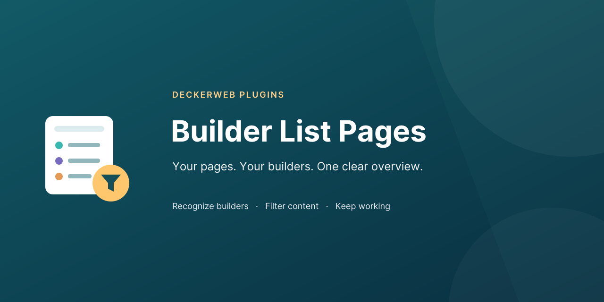

# Builder List Pages

**Your pages. Your builders. One clear overview.** Recognize builders in your content lists, filter Elementor, Bricks and other builder pages, and keep working in familiar WordPress screens. Useful for mixed websites, handovers and builder migrations.

**Version:** 1.1.0 · **Requires:** WordPress 6.7+ / PHP 8.0+ · **License:** GPL v2 or later

[Deutsch](README-de.md) · [User guide](docs/wiki/English.md) · [Extended FAQ](docs/wiki/FAQ-English.md) · [GitHub Releases](https://github.com/deckerweb/builder-list-pages/releases)

## Contents

- [At a glance](#at-a-glance)
- [Installation and first filter](#installation-and-first-filter)
- [Builders and recognition](#builders-and-recognition)
- [Settings](#settings)
- [Updates and Library](#updates-and-library)
- [New tools and personal views](#new-tools-and-personal-views)
- [FAQ](#faq)
- [Changelog](#changelog)
- [About](#about)
- [Issues, security and support](#issues-security-and-support)
- [License and included components](#license-and-included-components)

## At a glance

- **Recognize builders:** clickable Builder column, including multiple matches per item.
- **Filter quickly:** independent views for multiple active builders and “No recognized builder”.
- **Keep working:** builder selection stays in searches and standard list filters.
- **Familiar navigation:** builder submenus respect the post type’s editing permissions.
- **Little setup:** three optional switches, German translations, local guide and full changelog.
- **DECKERWEB integrated:** embedded GitHub Updater 2.1.0 and Plugin Library 0.9.0.

## Installation and first filter

1. Upload the plugin ZIP through **Plugins → Add New → Upload Plugin**, replacing the old plugin version if installed.
2. Activate it and open **Pages** or another content list enabled by an active supported builder.
3. Click a builder above the table. Then use the normal search if needed.
4. Adjust optional choices under **Settings → Builder List Pages**.

## Builders and recognition

Elementor, Bricks, Breakdance, Oxygen 6+, Oxygen Classic, Brizy, Beaver Builder, ZionBuilder, Thrive Architect, Pagelayer and Visual Composer. Visual Composer retains the free edition’s page/post scope. Astra and OceanWP post types retain their special menu navigation when available.

Recognition reads existing metadata for active supported builders enabled on the post type. “No recognized builder” does not automatically mean Gutenberg. The default views recognize active builders; the optional trace view checks inactive signatures. Global template assignments are not analyzed. Existence-based integrations retain their previous semantics even for empty values.

Counts describe the complete readable group outside trash, including unpublished content. Search and other list filters can reduce visible results. Builder groups can overlap.

## Settings

Enable or disable the Builder column, builder submenus and no-builder filter site-wide. Users can also hide the column individually through **Screen Options**. Administrators change settings; editors use list features according to normal editing permissions.

The local changelog opens in a keyboard-accessible dialog. Close it with Escape, the Close button or a click outside the dialog; focus returns to the link.

## Updates and Library

Stable GitHub releases appear in the regular WordPress update system through deckerweb Updater 2.1.0. No separate updater plugin is needed; automatic updates stay under your control.

The embedded deckerweb Library 0.9.0 adds **Plugins → Add New → deckerweb**, with a local approved catalog, series filters and plugin details. The standard WordPress tab remains the default. Installation, activation and updates require an explicit permitted action. Online catalog refresh is optional and off by default.

The Library follows the active compatible copy when multiple deckerweb plugins are installed. Its preferences are separate from the three Builder List Pages display settings.

## New tools and personal views

The **Multiple builders recognized** view collects content with at least two distinct active builder signatures. Duplicate copies of the same metadata field count once.

Open **Builder tools and personal views** above the native content list to select a view, save a named favorite, switch to a compact selector, inspect inactive builder traces, copy diagnostics or export a CSV. The tools remain collapsed by default; existing builder views remain the default. Bricks badges provide a separate editor link only when native Bricks permissions allow it.

**Inactive traces:** the optional read-only view checks known metadata signatures even when the corresponding builder is inactive. It does not activate builders, change content or prove which builder renders the frontend. Empty fields can count for existence-based signatures. Active builders disabled for a post type are not classified as inactive.

**Personal favorites:** save post type, builder, status and search for your own account on this site. Save the same name to update a favorite; up to 20 names are supported. Opening a favorite rechecks your access. Delete favorites individually; deactivation and uninstall retain them.

**Diagnostics:** select and copy the local text containing plugin, WordPress and PHP versions, supported active builder names and accessible post types. It omits website URLs, usernames, credentials and page contents. Nothing is automatically sent.

**CSV:** download title, status, recognized builders and edit link for the explicitly displayed builder/status/search selection, up to 5,000 readable and editable items. Other list filters are not included; the tool states this before download. CSV formulas are neutralized. Edit links contain the site URL, so the CSV is intended for a trusted handover, unlike the minimal support diagnostics.

An empty builder result explains the current builder, search and status. **Reset search** or **Remove builder filter** clears that one restriction while preserving the post type and other list filters.

Open **Recognition details** in a row to see the matched metadata field names and whether an empty value exists. No metadata values or builder content are displayed.

## FAQ

### Do I need to configure anything first?

No. Activate the plugin and open a content list that an active supported builder can edit. Views, the Builder column and builder submenus are enabled by default.

### Which builders are supported?

Elementor, Bricks, Breakdance, Oxygen 6+, Oxygen Classic, Brizy, Beaver Builder, ZionBuilder, Thrive Architect, Pagelayer and Visual Composer. Visual Composer currently uses the free edition’s page/post scope.

### What does “No recognized builder” mean?

No configured condition matched among active supported builders enabled for this post type. It does not prove the page uses Gutenberg.

### Can I hide the column?

Yes, individually in Screen Options on the list, or site-wide in Settings → Builder List Pages.

### What about Multisite?

The three display choices are stored separately for each site. Network activation loads the plugin on all sites, including newly created sites. The Library uses its own site and network controls; site administrators cannot manage its network preferences.

### Are prereleases installed automatically?

No. The updater offers stable GitHub releases only. Install test packages manually when needed. It does not turn on automatic updates.

### What happens when I deactivate or uninstall it?

Deactivation keeps all data. Uninstallation removes this plugin’s temporary update cache while keeping its three site settings, personal views/display preferences and all builder content. Shared Library caches and tasks are removed only when no other installed host needs them, including inactive hosts. Library preferences remain unless its separate cleanup option is enabled. Plugins installed through the Library are never removed.

[Complete FAQ by topic](docs/wiki/FAQ-English.md)

## Changelog

### Unreleased · 2026-10-10

- **New:** Adds a multiple-builder filter, optional inactive-trace audit, personal saved views, compact user display choice, minimal copyable diagnostics and an explicit CSV handover export.
- **Improved:** Explains empty results with independent search/builder recovery and clearer badge actions; adds permission-checked native Bricks editor links.
- **Improved:** Preserves personal favorites and preferences across deactivation and uninstall; limits exports to permitted items and neutralizes spreadsheet formulas.
- **Improved:** Updates bilingual banners and icons using the approved blue-petrol vector artwork and local Inter font outlines with the font license.

### 1.1.0 · 2026-10-01

- **New:** Optional Builder column with clickable builder names and overlapping matches.
- **New:** Independent views and submenus for multiple active builders.
- **New:** “No recognized builder” filter for content outside the detected builder groups.
- **New:** Compact settings page with deckerweb header, footer, local documentation and changelog dialog.
- **Improved:** Retains the builder selection when searching and filtering the content list.
- **Improved:** Centralizes builder metadata rules and resolves settings once per request.
- **Improved:** Counts readable published and unpublished content outside trash using ID-only queries.
- **Fixed:** Validates URL parameters and targets only the main supported admin list.
- **Fixed:** Preserves existing meta query groups and handles missing or malformed builder options.
- **Fixed:** Uses post-type editing permissions for builder submenus instead of theme permissions.
- **Fixed:** Prevents WP Admin Cleaner from incorrectly blocking builder lists when a hidden Bricks menu slug matches the end of their URL. Existing list links are normalized automatically while preserving search and filters.
- **Misc:** Integrates the shared deckerweb GitHub Updater V2 and embedded Plugin Library 0.2.0.
- **Misc:** Raises minimum PHP to 8.0 for the embedded Library; WordPress 6.7 remains the minimum.
- **Misc:** Adds bilingual readmes, guides, FAQs, translations, release tooling and regression checks.

### 1.0.0 · 2025-04-11

- **New:** Initial public release with views and submenus for eleven builders.

[Changelog](docs/wiki/Changelog-English.md)

## About

Created and maintained by David Decker – DECKERWEB. © 2019–2026. Builder List Pages began in 2019 and complements native content lists; it reads metadata without converting pages or loading frontend assets.

## Issues, security and support

Report reproducible problems through [GitHub Issues](https://github.com/deckerweb/builder-list-pages/issues). Report security vulnerabilities privately using the [security policy](SECURITY.md); never publish exploit details or credentials in an issue.

Support development through [Ko-fi](https://ko-fi.com/deckerweb), [Buy Me a Coffee](https://buymeacoffee.com/daveshine) or [PayPal](https://paypal.me/deckerweb).

## License and included components

GPL v2 or later. [License](LICENSE). Includes deckerweb Plugin Library 0.9.0 and deckerweb Updater 2.1.0 by David Decker – DECKERWEB, both GPL-2.0-or-later. The shared changelog renderer originates from [Advanced Scripts QuickNav](https://github.com/deckerweb/advanced-scripts-quicknav), `includes/deckerweb-changelog-v1.php`, by the same author under GPL-2.0-or-later. No premium builder or Admin Cleaner code is included.

The banners and icon use native vector shapes. Banners include Inter lettering converted to paths, linear background gradients and transparency; no raster images, live fonts, SVG filters or external resources. Icons use native shapes and solid fills. PNGs are rendered from those same SVGs. Inter is free for commercial use under SIL Open Font License 1.1; [font license](assets/Inter-OFL.txt) is included, without font files.
