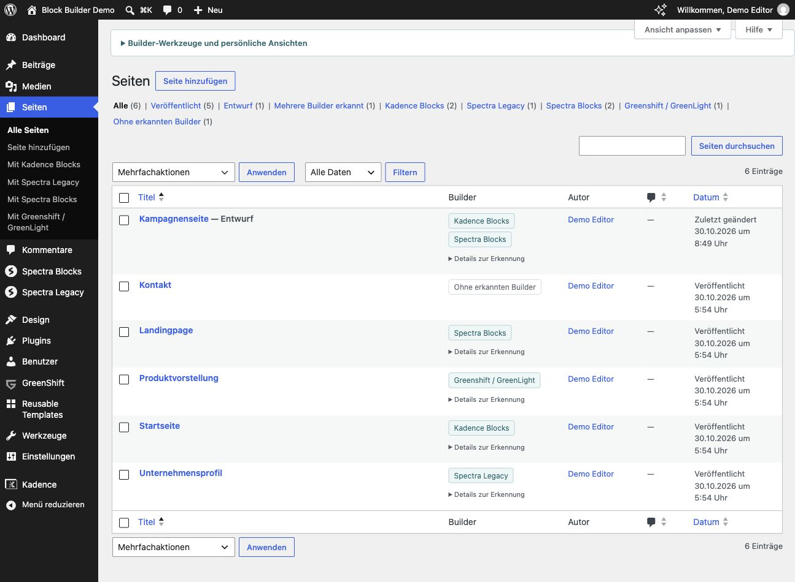
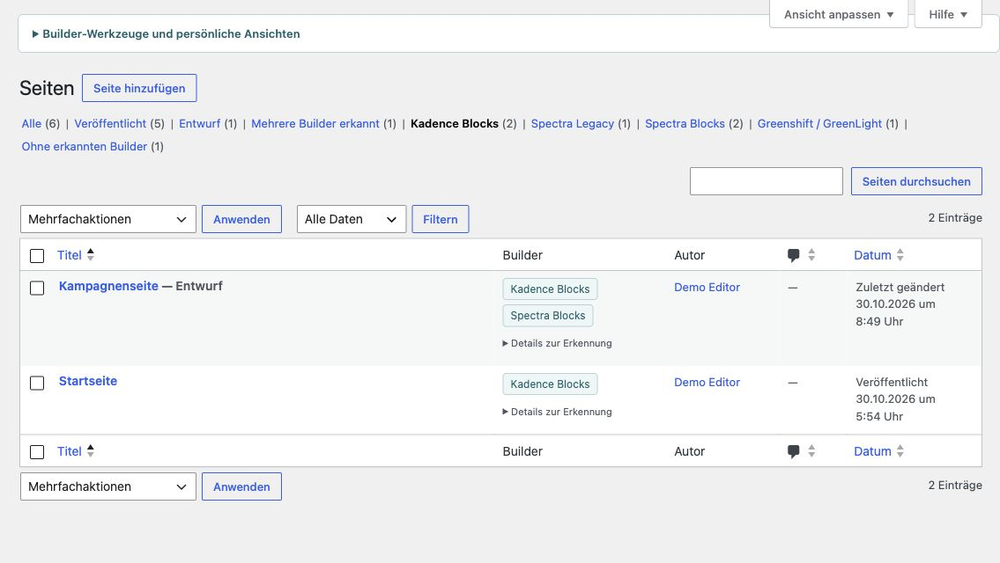
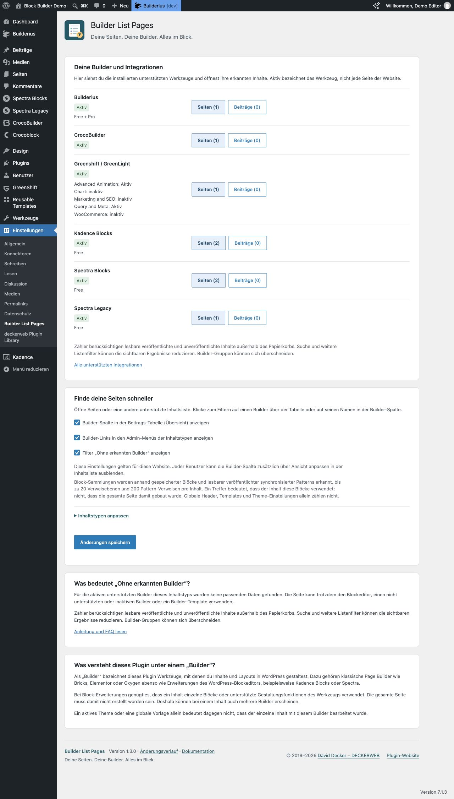
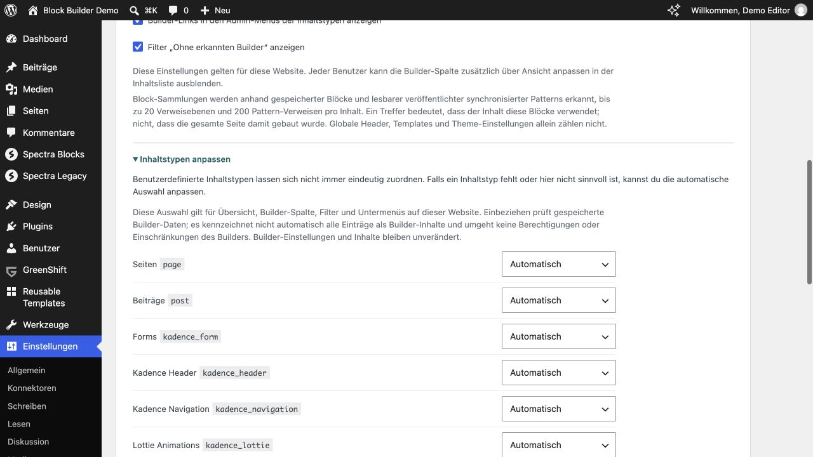
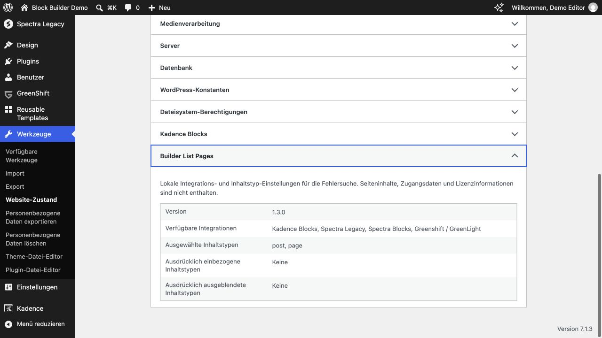
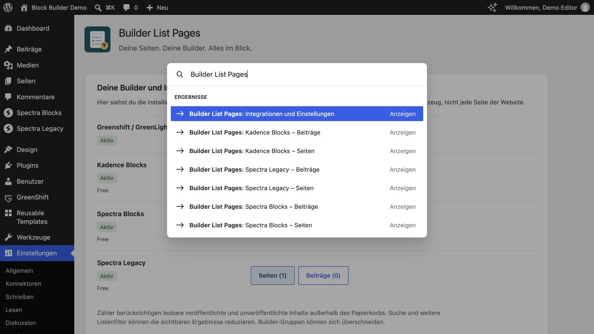

# Anleitung

Builder List Pages 1.3.0 · [FAQ](FAQ-Deutsch.md) · [English](English.md)

## Auf einen Blick

- **Dein Werkzeug finden:** getrennte Tabellen für klassische Page Builder und blockbasierte Builder mit kurzen Free-/Pro-Hinweisen.
- **Integrationen überblicken:** installierte Werkzeuge, Aktiv-/Inaktiv-Status und direkte Inhaltslinks mit lesbaren Trefferzahlen.
- **Treffer schneller sehen:** Inhaltstypen mit Treffern zuerst; innerhalb der Gruppen Seiten vor Beiträgen, mit eigenen dezenten Farben.
- **Inhaltstypen auswählen:** automatische Vorauswahl plus Automatisch, Ausblenden und Einbeziehen pro Website.
- **Gemischte Inhalte erkennen:** anklickbare Builder-Namen, Mehrfach-Builder-Ansicht und inaktive Spuren.
- **Direkt weiterarbeiten:** Suche, persönliche Favoriten, CSV-Export und vertraute WordPress-Listen.
- **WordPress-Werkzeuge nutzen:** lokale Informationen im Website-Zustand und Sprungziele in der verfügbaren Befehlspalette.
- **Passende Sprache:** Englisch, Deutsch und Deutsch (Sie); lokale Anleitung und vollständiger Änderungsverlauf.
- **DECKERWEB integriert:** GitHub Updater 2.2.1 und Plugin Library 1.2.0.

## Installation und erster Filter

1. Plugin-ZIP über **Plugins → Installieren → Plugin hochladen** installieren beziehungsweise die alte Plugin-Version ersetzen.
2. Plugin aktivieren und **Seiten** oder eine andere vom aktiven Builder unterstützte Inhaltsliste öffnen.
3. Einen Builder-Namen über der Tabelle anklicken. Anschließend bei Bedarf die Suche verwenden.
4. Einstellungen bei Bedarf unter **Einstellungen → Builder List Pages** anpassen.

### Schritt 1: Builder erkennen

Öffne **Seiten → Alle Seiten**. In der Spalte **Builder** stehen die erkannten Werkzeuge. Eine Seite kann mehrere Namen tragen.

### Schritt 2: Passende Seiten filtern

Klicke auf einen Builder über der Tabelle oder auf seinen Namen in einer Zeile. Im Beispiel bleiben die beiden Seiten mit Kadence-Blöcken sichtbar; eine davon enthält zusätzlich Spectra-Blöcke. **Alle** öffnet wieder die vollständige Liste.

## Builder und Erkennung

Klassische Page Builder und blockbasierte Builder sind übersichtlich getrennt aufgelistet. [Unterstützte Builder ansehen](Builders-Deutsch.md).

Seiten können mehrere Builder oder Block-Sammlungen verwenden. Die Builder-Spalte zeigt die erkannten Werkzeuge; ein Klick filtert die Liste. Bedingungen stehen kurz in der Übersicht, ausführliche Hinweise auf der Seite zu Sonderfällen.

### Was versteht dieses Plugin unter einem „Builder“?

Als „Builder“ bezeichnet dieses Plugin Werkzeuge, mit denen du Inhalte und Layouts in WordPress gestaltest. Dazu gehören klassische Page Builder wie Bricks, Elementor oder Oxygen ebenso wie Erweiterungen des WordPress-Blockeditors, beispielsweise Kadence Blocks oder Spectra.

Bei Block-Erweiterungen genügt es, dass ein Inhalt einzelne Blöcke oder unterstützte Gestaltungsfunktionen des Werkzeugs verwendet. Die gesamte Seite muss damit nicht erstellt worden sein. Deshalb können bei einem Inhalt auch mehrere Builder erscheinen.

Ein aktives Theme oder eine globale Vorlage allein bedeutet dagegen nicht, dass der einzelne Inhalt mit diesem Builder bearbeitet wurde.

Etch wird anhand der direkt gespeicherten Etch-Blöcke erkannt. Ein aktives Etch-Theme oder ein Etch-Block im globalen Header oder Footer allein macht eine Seite nicht zu einem Etch-Inhalt.

CrocoBuilder erkennt direkt aktivierte Inhalte; PHP 8.2 und WordPress 7.0 sind dafür erforderlich. Builderius Free/Pro erkennt ausdrücklich einem Inhalt zugeordnete, aktivierte Seiten-Templates. Diese gespeicherte Editor-Zuweisung sagt nicht aus, welcher Entwicklungsstand bereits live veröffentlicht wurde. Automatische und globale Templates werden nicht zugerechnet. Builderius benötigt PHP 8.2. Auf älteren Systemen bleiben die übrigen Integrationen nutzbar.

### Klassische Page Builder

| Werkzeug | Unterstützt | Kurzinfo |
|---|---|---|
| Beaver Builder | Ja | Free / Pro |
| Breakdance | Ja | — |
| Bricks | Ja | — |
| Brizy | Ja | Free / Pro |
| Builderius | Ja | Free / Pro; gespeicherte direkte Seiten-Templates, PHP 8.2+ |
| CrocoBuilder | Ja | Direkt aktivierte Inhalte; WP 7.0+ / PHP 8.2+ |
| Divi | Ja | Divi 4 / 5; Theme oder Builder-Plugin |
| Elementor | Ja | Free / Pro |
| Mosaic | Ja | Direkte Layout-Zuweisungen; WP 6.9+ / PHP 8.2+ |
| Oxygen | Ja | Oxygen Classic und Oxygen 6 |
| Pagelayer | Ja | — |
| SiteOrigin | Ja | Seitenlayouts und eingebettete Layout-Blöcke; Free / Premium |
| Thrive Architect | Ja | Direkte Architect-Inhalte; keine globalen Theme-Templates |
| Visual Composer | Ja | Website Builder; nicht WPBakery |
| Zion Builder | Ja | Free / Pro |

### Blockbasierte Builder

| Werkzeug | Unterstützt | Kurzinfo |
|---|---|---|
| Essential Blocks | Ja | Free / Pro |
| Etch | Ja | Direkte Etch-Inhalte; Theme allein genügt nicht |
| GenerateBlocks | Ja | Free / Pro |
| Genesis Blocks | Ja | Genesis-Blöcke; keine unveränderten Atomic-Blocks-Inhalte |
| Greenshift / GreenLight | Ja | Gespeicherte Blöcke, einschließlich Addons; Addon-Status in der Übersicht |
| GutenKit | Ja | Free-Blöcke |
| Kadence Blocks | Ja | Free / Pro; auch Kadence-Blöcke aus Creative Kit und importierten Vorlagen |
| Kubio | Ja | Eigene Blöcke und erkannte Kubio-Stile; keine globale Template-Zuordnung |
| Otter Blocks | Ja | Otter- und Atomic-Wind-Blöcke sowie gespeicherte Otter-Bedingungen |
| Spectra Blocks | Ja | Free / Pro |
| Spectra Legacy | Ja | Free / Pro |
| Stackable | Ja | Free / Premium; aktuelle und ältere Blöcke |

## Einstellungen

Unter **Einstellungen → Builder List Pages** siehst du installierte unterstützte Werkzeuge, ihren Aktiv-/Inaktiv-Status und erkannte Free-/Pro-Ausgaben. Ein inaktives Pro-Addon ist gesondert gekennzeichnet. Die Ausgabenbezeichnungen beschreiben Pakete, keinen Lizenzstatus.

Über einen Button pro Inhaltstyp öffnest du die gefilterte Liste. Inhaltstypen mit Treffern erscheinen zuerst; innerhalb der Gruppen führen Seiten und danach Beiträge. Seiten mit Treffern sind dezent blau, Beiträge violett und weitere Inhaltstypen grün hinterlegt. Nulltreffer bleiben neutral und anklickbar. Die Zahlen umfassen lesbare veröffentlichte und unveröffentlichte Inhalte außerhalb des Papierkorbs; Gruppen können sich überschneiden. Inaktive Integrationen erhalten keine Inhaltslinks.

Die drei Anzeigeschalter steuern Builder-Spalte, Builder-Untermenüs und Ohne-Builder-Filter für diese Website. Die Spalte lässt sich zusätzlich persönlich über **Ansicht anpassen** ausblenden.

### Inhaltstypen anpassen

Öffne **Inhaltstypen anpassen**. Jeder registrierte geeignete Inhaltstyp erscheint mit Name und Slug. Wähle **Automatisch**, **Ausblenden** oder **Einbeziehen** und anschließend **Änderungen speichern**. Die automatische Vorauswahl lässt bekannte System-, Redirect-, Consent-, Formularverwaltungs- und Protokolltypen weg. Eigene Inhaltstypen lassen sich nicht immer eindeutig zuordnen; passe die Auswahl bei Bedarf an.

Die Auswahl gilt für Übersicht, Spalte, Filter, Untermenüs und Befehle. Einbeziehen prüft gespeicherte Erkennungsmerkmale; es erklärt nicht alle Einträge zu Builder-Inhalten und umgeht keine Bearbeitungsrechte oder Einschränkungen des Builders. Auch ein eigener Inhaltstyp ohne normalen Editor kann einbezogen werden. Systemdatensätze und interne Builder-Bibliotheken bleiben ausgeschlossen. Builder-Einstellungen und Inhalte ändern sich dadurch nicht. Mit Automatisch entfernst du die Ausnahme. Werte vorübergehend fehlender Plugins bleiben erhalten. Die Einstellungen gelten für diese Website und bleiben bei Deaktivierung und Deinstallation bestehen.

Der vorhandene Ohne-Builder-Hinweis bleibt erhalten; darunter erklärt ein eigener Abschnitt klassische Builder und Block-Erweiterungen verständlich. Der lokale Änderungsverlauf öffnet sich als tastaturbedienbarer Dialog; Escape oder Schließen führt zum Ausgangslink zurück.

Bei GreenShift erscheinen installierte Addons mit ihrem jeweiligen Aktiv-Status unter der gemeinsamen Integration. Die Inhaltszähler werden nicht je Addon wiederholt. Ein aktives Addon ohne verfügbare Basis macht die Erkennung nicht verfügbar.

## Updates und Library

Stabile GitHub-Releases erscheinen über deckerweb Updater 2.2.1 im normalen WordPress-Updatesystem. Ein separates Updater-Plugin ist nicht nötig; automatische Updates bleiben unter deiner Kontrolle.

Die eingebettete deckerweb Library 1.2.0 ergänzt **Plugins → Installieren → deckerweb** mit einem lokalen freigegebenen Katalog, Serienfiltern und Plugin-Details. Der normale WordPress-Tab bleibt die Vorgabe. Installation, Aktivierung und Updates erfordern eine ausdrückliche Aktion mit passenden Rechten. Der Online-Katalog ist optional und standardmäßig ausgeschaltet.

Bei mehreren deckerweb Plugins übernimmt die aktive kompatible Library-Kopie. Ihre Einstellungen sind von den drei Anzeigeoptionen von Builder List Pages getrennt.

## Neue Werkzeuge und persönliche Ansichten

Die Ansicht **Mehrere Builder erkannt** sammelt Inhalte mit mindestens zwei unterschiedlichen Signaturen aktiver Builder. Doppelte Kopien desselben Metadatenfelds zählen einmal.

Öffne **Builder-Werkzeuge und persönliche Ansichten** oberhalb der normalen Inhaltsliste, um eine Ansicht auszuwählen, einen benannten Favoriten zu speichern, zur kompakten Auswahl zu wechseln, inaktive Builder-Spuren zu prüfen, Diagnosedaten zu kopieren oder eine CSV herunterzuladen. Die Werkzeuge bleiben standardmäßig zugeklappt; die bisherigen Builder-Ansichten bleiben Standard. Bricks-Kennzeichen bieten einen getrennten Bearbeitungslink, wenn die eigenen Bricks-Berechtigungen ihn erlauben.

**Inaktive Spuren:** Die optionale, rein lesende Ansicht prüft bekannte Metadaten-Signaturen auch bei deaktiviertem Builder. Sie aktiviert keine Builder, verändert keine Inhalte und beweist nicht, welcher Builder das Frontend darstellt. Bei existenzbasierter Erkennung können leere Felder zählen. Aktive Builder, die für einen Inhaltstyp abgeschaltet sind, gelten nicht als inaktiv.

**Persönliche Favoriten:** Speichere Inhaltstyp, Builder, Status und Suche für dein Benutzerkonto auf dieser Website. Derselbe Name aktualisiert einen Favoriten; bis zu 20 Namen werden unterstützt. Beim Öffnen werden deine Rechte erneut geprüft. Favoriten lassen sich einzeln löschen; Deaktivierung und Deinstallation erhalten sie.

**Diagnose:** Wähle den lokalen Text aus und kopiere ihn. Er enthält Plugin-, WordPress- und PHP-Version, Namen unterstützter aktiver Builder und zugängliche Inhaltstypen. Website-URLs, Benutzernamen, Zugangsdaten und Seiteninhalte fehlen. Es wird nichts automatisch gesendet.

**CSV:** Lade Titel, Status, erkannte Builder und Bearbeitungslink für die ausdrücklich angezeigte Auswahl nach Builder/Status/Suche herunter, mit bis zu 5.000 lesbaren und bearbeitbaren Inhalten. Andere Listenfilter werden nicht berücksichtigt; der Hinweis steht vor dem Download. Tabellenformeln werden entschärft. Bearbeitungslinks enthalten die Website-URL; die CSV ist für eine vertrauliche Übergabe gedacht, im Unterschied zur sparsamen Support-Diagnose.

Ein leeres Builder-Ergebnis erklärt Builder, Suche und Status. **Suche zurücksetzen** oder **Builder-Filter aufheben** entfernt nur diese Einschränkung und erhält Inhaltstyp und weitere Listenfilter.

Öffne **Details zur Erkennung** in einer Zeile, um die Namen erkannter Metadatenfelder und einen Hinweis auf leere Werte zu sehen. Metadatenwerte und Builder-Inhalte werden nicht angezeigt.

## Feature Highlights

### Dein Werkzeug sofort erkennen

Getrennte Tabellen zeigen klassische Page Builder und Block-Bibliotheken. Free-/Pro-Hinweise und kurze Bedingungen machen die Unterstützung schnell verständlich.

### Mit einem Klick zu den passenden Inhalten

Sieh installierte Werkzeuge und ihren Status und öffne direkt erkannte Seiten, Beiträge oder eigene Inhalte. Inhaltstypen mit Treffern stehen vorn und erhalten dezente Farben.

### Sinnvolle Inhaltstypen mit Platz für Ausnahmen

Die Vorauswahl hält technische Datensätze aus dem Weg. Passe einzelne Inhaltstypen über Ausblenden oder Einbeziehen an – einheitlich im gesamten Plugin.

### Vertraute WordPress-Abläufe

Arbeite mit normalen Listen, Suche und Berechtigungen sowie persönlichen Ansichten und CSV-Übergaben. Informationen im Website-Zustand helfen beim Support; verfügbare Befehle beschleunigen die Navigation.

### Beliebte Page Builder und Block-Werkzeuge erkennen

Finde Inhalte, die du mit Bricks, Elementor, Breakdance und vielen weiteren beliebten Page Buildern gestaltet hast. Auch blockbasierte Werkzeuge wie Kadence Blocks, Spectra und GenerateBlocks werden unterstützt – jeweils in Free und Pro. Dazu kommen Etch, GreenShift und Mosaic Builder mit direkt zugewiesenen Layouts. Globale Header, Footer und automatische Templates werden nicht pauschal jeder Seite zugerechnet.

## WordPress-Werkzeuge

**Werkzeuge → Website-Zustand → Bericht → Builder List Pages** zeigt Plugin-Version, verfügbare Integrationen, ausgewählte Inhaltstypen und ausdrückliche Ausnahmen. Seiteninhalte, Zugangsdaten und Lizenzinformationen fehlen bewusst; nichts wird automatisch versendet. Inaktive Builder und Nulltreffer erzeugen keine Zustandswarnung.

Wo WordPress die **Befehlspalette** bereits bereitstellt, suche nach **Builder List Pages**. Administratoren öffnen Integrationen und Einstellungen; Benutzer mit Bearbeitungsrechten springen zu passenden Builder-/Inhaltstyp-Listen. Befehle beachten dieselbe Inhaltstyp-Auswahl und die normalen Bearbeitungsrechte. Das Plugin ergänzt keine eigene Palette und erzwingt sie nicht auf älteren Oberflächen. Für Befehle werden keine Inhalte durchsucht oder Treffer gezählt.

[Auswahlregeln und Entwicklerfilter im Detail](Recognition-Deutsch.md#inhaltstyp-auswahl)

## Über das Projekt

Entwickelt und gepflegt von David Decker – DECKERWEB. © 2019–2026. Builder List Pages entstand 2019 und ergänzt die normalen Inhaltslisten. Es liest Metadaten, ohne Seiten umzuwandeln oder Frontend-Assets zu laden.

[Plugin-Website](https://deckerwebplugins.com/de/plugins/builder-list-pages/)

## Fehler, Sicherheit und Unterstützung

Melde nachvollziehbare Probleme über [GitHub Issues](https://github.com/deckerweb/builder-list-pages/issues). Sicherheitslücken bitte vertraulich über den [Sicherheitsmeldeweg](https://github.com/deckerweb/builder-list-pages/blob/main/SECURITY.md) melden; keine Exploit-Details oder Zugangsdaten in einem öffentlichen Issue veröffentlichen.

Unterstütze die Entwicklung über [Ko-fi](https://ko-fi.com/deckerweb), [Buy Me a Coffee](https://buymeacoffee.com/daveshine) oder [PayPal](https://paypal.me/deckerweb).

## Lizenz und enthaltene Komponenten

GPL v2 oder neuer. [Lizenz](https://github.com/deckerweb/builder-list-pages/blob/main/LICENSE). Enthält deckerweb Plugin Library 1.2.0 und deckerweb Updater 2.2.1 von David Decker – DECKERWEB, beide unter GPL-2.0-or-later. Der gemeinsame Changelog-Renderer stammt aus [Advanced Scripts QuickNav](https://github.com/deckerweb/advanced-scripts-quicknav), `includes/deckerweb-changelog-v1.php`, vom selben Autor unter GPL-2.0-or-later. Premium-Code von Buildern oder Admin Cleaner wird nicht mitgeliefert.

Banner und Icon verwenden native Vektorformen. Die Banner enthalten Inter-Schriftpfade, lineare Hintergrundverläufe und Transparenz; keine Rasterbilder, Live-Schriften, SVG-Filter oder externen Ressourcen. Icons verwenden native Formen und Vollfarben. PNGs werden aus denselben SVGs gerendert. Inter ist unter SIL Open Font License 1.1 kostenlos kommerziell nutzbar; die [Schriftlizenz](https://github.com/deckerweb/builder-list-pages/blob/main/assets/Inter-OFL.txt) liegt ohne Fontdateien bei.
