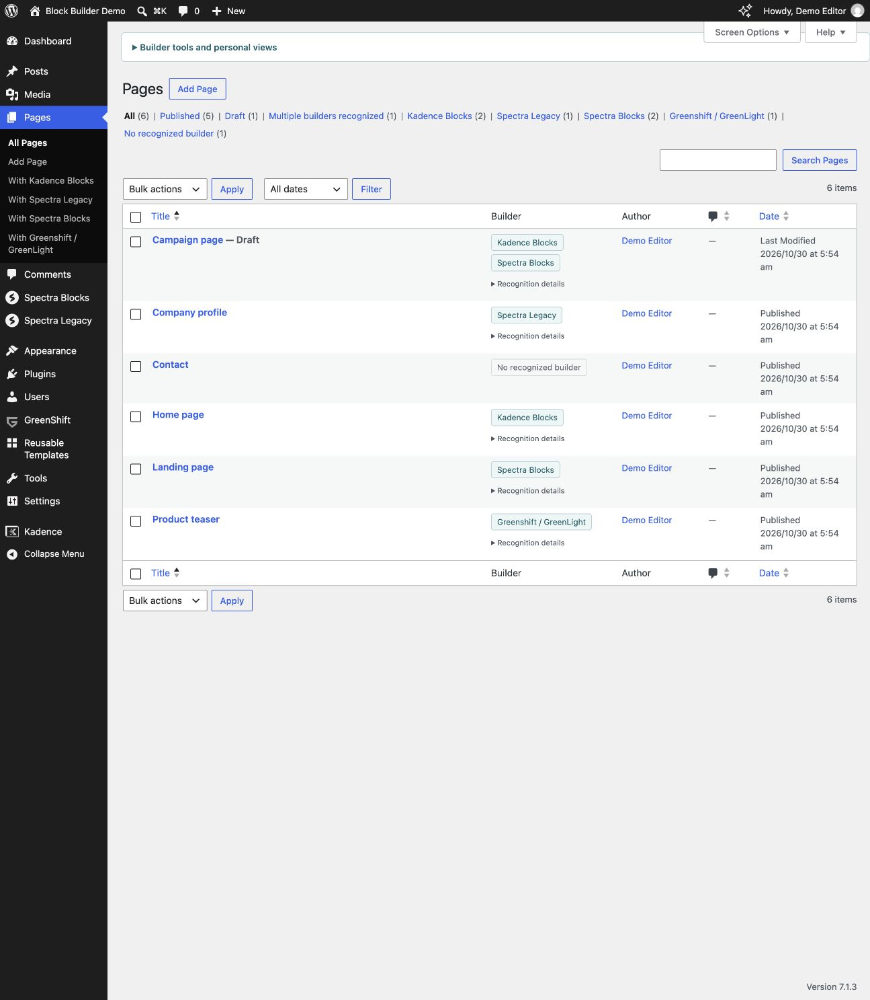
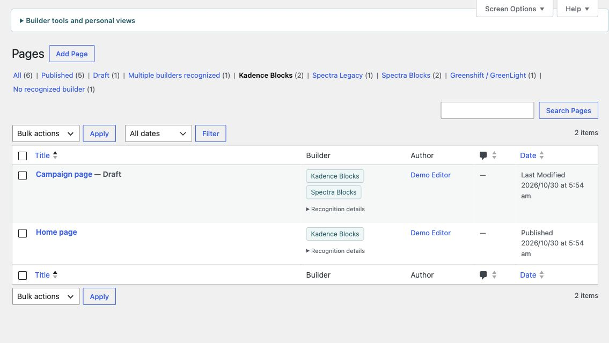
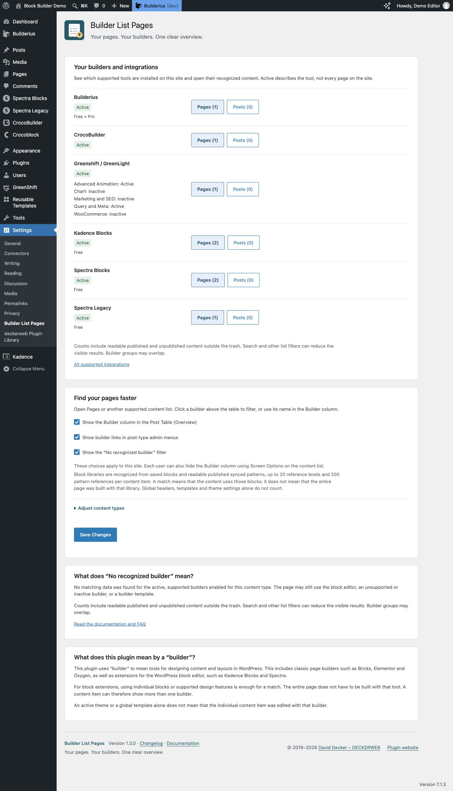
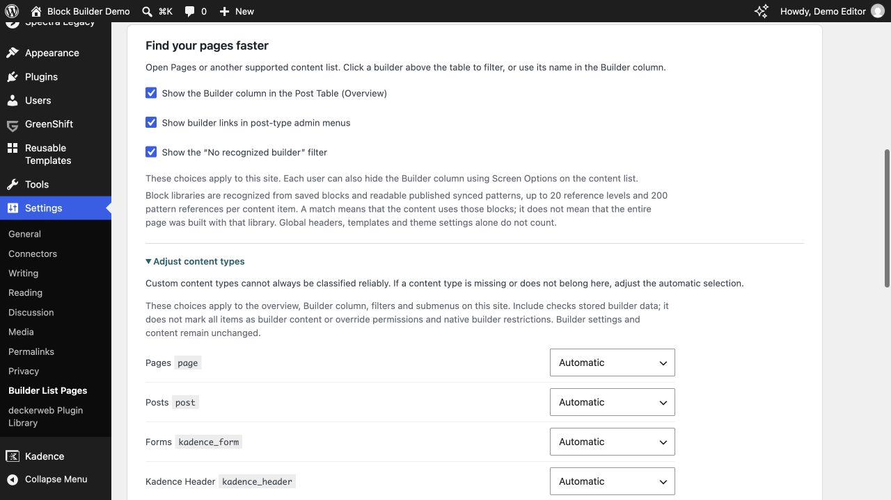
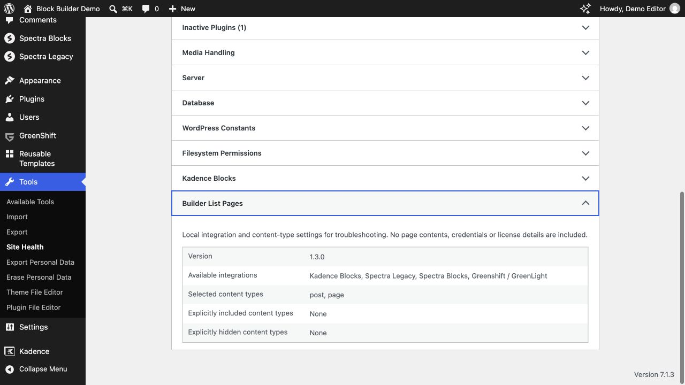
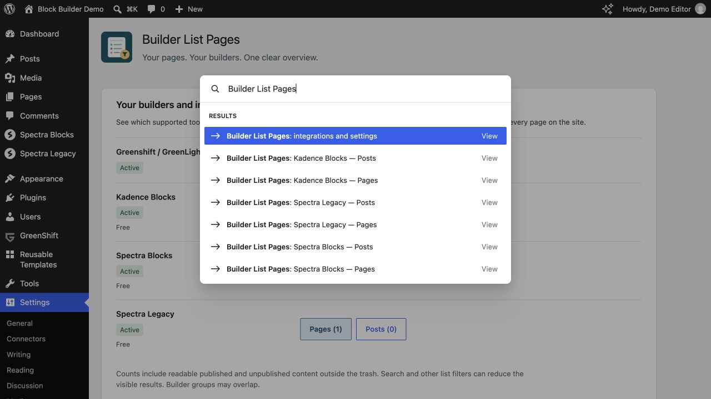

# User guide

Builder List Pages 1.3.0 · [FAQ](FAQ-English.md) · [Deutsch](Deutsch.md)

## At a Glance

- **Find your tool:** separate support tables for classic page builders and block-based builders, with concise Free/Pro notes.
- **See your integrations:** installed tools, active/inactive status and direct content-type links with readable counts.
- **Spot useful results:** matching content types first; Pages then Posts within each group, with distinct subtle colors.
- **Choose content types:** automatic selection plus per-site Automatic, Hide and Include controls.
- **Recognize mixed content:** clickable Builder badges, multiple-builder views and inactive traces.
- **Keep working:** searches, personal favorites, CSV exports and familiar WordPress lists.
- **Native WordPress tools:** local Site Health information and shortcuts in the available Command Palette.
- **Your language:** English, German and formal German; bundled guide and full changelog.
- **DECKERWEB integrated:** GitHub Updater 2.2.1 and Plugin Library 1.2.0.

## Installation and first filter

1. Upload the plugin ZIP through **Plugins → Add New → Upload Plugin**, replacing the old plugin version if installed.
2. Activate it and open **Pages** or another content list enabled by an active supported builder.
3. Click a builder above the table. Then use the normal search if needed.
4. Adjust optional choices under **Settings → Builder List Pages**.

### Step 1: Recognize builders

Open **Pages → All Pages**. The **Builder** column lists recognized tools. A page can show several names.

### Step 2: Filter matching pages

Click a builder above the table or its name in a row. The example keeps the two pages using Kadence blocks; one also contains Spectra blocks. **All** returns to the full list.

## Builders and recognition

Classic page builders and block-based builders are listed separately. [View supported builders](Builders-English.md).

Pages can use several builders or block collections. The Builder column shows recognized tools; click a name to filter the list. The overview lists conditions briefly, with detailed explanations on the special cases page.

### What does this plugin mean by a “builder”?

This plugin uses “builder” to mean tools for designing content and layouts in WordPress. This includes classic page builders such as Bricks, Elementor and Oxygen, as well as extensions for the WordPress block editor, such as Kadence Blocks and Spectra.

For block extensions, using individual blocks or supported design features is enough for a match. The entire page does not have to be built with that tool. A content item can therefore show more than one builder.

An active theme or a global template alone does not mean that the individual content item was edited with that builder.

Etch is recognized from directly stored Etch blocks. An active Etch theme or an Etch block in a global header or footer alone does not make a page an Etch content item.

CrocoBuilder recognizes directly enabled content and requires PHP 8.2 and WordPress 7.0. Builderius Free/Pro recognizes enabled page templates explicitly assigned to a content item. This saved editor assignment does not indicate which development state has been published live. Automatic and global templates are excluded. Builderius requires PHP 8.2. Other integrations remain available on older systems.

### Classic page builders

| Tool | Supported | Note |
|---|---|---|
| Beaver Builder | Yes | Free / Pro |
| Breakdance | Yes | — |
| Bricks | Yes | — |
| Brizy | Yes | Free / Pro |
| Builderius | Yes | Free / Pro; saved direct page templates, PHP 8.2+ |
| CrocoBuilder | Yes | Directly enabled content; WP 7.0+ / PHP 8.2+ |
| Divi | Yes | Divi 4 / 5; theme or builder plugin |
| Elementor | Yes | Free / Pro |
| Mosaic | Yes | Direct layout assignments; WP 6.9+ / PHP 8.2+ |
| Oxygen | Yes | Oxygen Classic and Oxygen 6 |
| Pagelayer | Yes | — |
| SiteOrigin | Yes | Page layouts and embedded layout blocks; Free / Premium |
| Thrive Architect | Yes | Direct Architect content; excludes global theme templates |
| Visual Composer | Yes | Website Builder; not WPBakery |
| Zion Builder | Yes | Free / Pro |

### Block-based builders

| Tool | Supported | Note |
|---|---|---|
| Essential Blocks | Yes | Free / Pro |
| Etch | Yes | Direct Etch content; the theme alone is not sufficient |
| GenerateBlocks | Yes | Free / Pro |
| Genesis Blocks | Yes | Genesis blocks; excludes unchanged Atomic Blocks content |
| Greenshift / GreenLight | Yes | Stored blocks, including addons; addon status in the overview |
| GutenKit | Yes | Free blocks |
| Kadence Blocks | Yes | Free / Pro; includes Kadence blocks from Creative Kit and imported templates |
| Kubio | Yes | Own blocks and recognized Kubio styles; excludes global template assignment |
| Otter Blocks | Yes | Otter and Atomic Wind blocks, plus stored Otter conditions |
| Spectra Blocks | Yes | Free / Pro |
| Spectra Legacy | Yes | Free / Pro |
| Stackable | Yes | Free / Premium; current and legacy blocks |

## Settings

Open **Settings → Builder List Pages** to see installed supported tools, active/inactive status and recognized Free/Pro editions. An inactive Pro addon is marked separately. Edition labels describe distributions, not license status.

Use a content-type button to open its filtered list. Types with matching content appear first; Pages, then Posts lead each group. Matching Pages use pale blue, Posts pale violet and other types pale green. Zero-result buttons stay neutral and usable. Counts include readable published and unpublished items outside the trash; groups can overlap. Inactive integrations have no content links.

The three display switches control the Builder column, builder submenus and no-builder filter site-wide. Users can also hide the column through **Screen Options**.

### Adjust content types

Expand **Adjust content types**. Each registered eligible content type shows its name and slug. Choose **Automatic**, **Hide** or **Include**, then **Save Changes**. Automatic omits known system, redirect, consent, form-management and log types. Custom types cannot always be classified reliably, so override the selection if needed.

The selection applies to the overview, column, filters, submenus and command shortcuts. Include checks stored signatures; it does not label every item as builder content or override editing permissions and native builder restrictions. It can include a custom type that lacks the standard editor. System records and internal builder libraries remain excluded. These choices do not change builder settings or content. Return a type to Automatic to remove its override. Values belonging to temporarily absent plugins are retained. Settings apply to this site and survive deactivation and uninstall.

The existing no-builder explanation remains, followed by a plain-language definition of classic builders and block extensions. The local changelog opens in a keyboard-accessible dialog; Escape or Close returns focus to its link.

Installed GreenShift addons appear with their individual active/inactive status within the shared integration. Content counts are not repeated for each addon. An active addon without the available base does not enable recognition.

## Updates and Library

Stable GitHub releases appear in the regular WordPress update system through deckerweb Updater 2.2.1. No separate updater plugin is needed; automatic updates stay under your control.

The embedded deckerweb Library 1.2.0 adds **Plugins → Add New → deckerweb**, with a local approved catalog, series filters and plugin details. The standard WordPress tab remains the default. Installation, activation and updates require an explicit permitted action. Online catalog refresh is optional and off by default.

The Library follows the active compatible copy when multiple deckerweb plugins are installed. Its preferences are separate from the three Builder List Pages display settings.

## New tools and personal views

The **Multiple builders recognized** view collects content with at least two distinct active builder signatures. Duplicate copies of the same metadata field count once.

Open **Builder tools and personal views** above the native content list to select a view, save a named favorite, switch to a compact selector, inspect inactive builder traces, copy diagnostics or export a CSV. The tools remain collapsed by default; existing builder views remain the default. Bricks badges provide a separate editor link only when native Bricks permissions allow it.

**Inactive traces:** the optional read-only view checks known metadata signatures even when the corresponding builder is inactive. It does not activate builders, change content or prove which builder renders the frontend. Empty fields can count for existence-based signatures. Active builders disabled for a post type are not classified as inactive.

**Personal favorites:** save post type, builder, status and search for your own account on this site. Save the same name to update a favorite; up to 20 names are supported. Opening a favorite rechecks your access. Delete favorites individually; deactivation and uninstall retain them.

**Diagnostics:** select and copy the local text containing plugin, WordPress and PHP versions, supported active builder names and accessible post types. It omits website URLs, usernames, credentials and page contents. Nothing is automatically sent.

**CSV:** download title, status, recognized builders and edit link for the explicitly displayed builder/status/search selection, up to 5,000 readable and editable items. Other list filters are not included; the tool states this before download. CSV formulas are neutralized. Edit links contain the site URL, so the CSV is intended for a trusted handover, unlike the minimal support diagnostics.

An empty builder result explains the current builder, search and status. **Reset search** or **Remove builder filter** clears that one restriction while preserving the post type and other list filters.

Open **Recognition details** in a row to see the matched metadata field names and whether an empty value exists. No metadata values or builder content are displayed.

## Feature Highlights

### Your tool, immediately visible

Find classic page builders and block libraries in separate support tables. Free/Pro notes and short conditions make compatibility easy to assess.

### From integration to content in one click

See installed tools and their status, then jump directly to recognized Pages, Posts or custom content. Matching types lead the list and receive subtle colors.

### Useful content types, with room for exceptions

Automatic selection keeps technical records out of the way. Override individual types with Hide or Include, consistently across the plugin.

### Familiar WordPress workflows

Use the normal lists, searches and permissions, plus personal views and CSV handovers. Site Health information helps with support; available Command Palette shortcuts speed up navigation.

### Recognize popular page builders and block tools

Find content designed with Bricks, Elementor, Breakdance and many other popular page builders. Block-based tools such as Kadence Blocks, Spectra and GenerateBlocks are also supported, in both Free and Pro. Etch and GreenShift are supported too, along with directly assigned Mosaic Builder layouts. Global headers, footers and automatic templates are not automatically attributed to every page.

## WordPress tools

**Tools → Site Health → Info → Builder List Pages** lists the plugin version, available integrations, selected content types and explicit overrides. It contains no page contents, credentials or license information and sends nothing automatically. Inactive builders and zero results are not health warnings.

Where WordPress already offers the **Command Palette**, search for **Builder List Pages**. Administrators can open integrations and settings; users with editing permissions can open the appropriate builder/type lists. Commands respect the same content-type selection and native editing permissions. The plugin does not add a separate palette or force it onto older screens. It does not scan content or calculate counts for commands.

[Detailed selection rules and developer filter](Recognition-English.md#content-type-selection)

## About

Created and maintained by David Decker – DECKERWEB. © 2019–2026. Builder List Pages began in 2019 and complements native content lists; it reads metadata without converting pages or loading frontend assets.

[Plugin website](https://deckerwebplugins.com/en/plugins/builder-list-pages/)

## Issues, security and support

Report reproducible problems through [GitHub Issues](https://github.com/deckerweb/builder-list-pages/issues). Report security vulnerabilities privately using the [security policy](https://github.com/deckerweb/builder-list-pages/blob/main/SECURITY.md); never publish exploit details or credentials in an issue.

Support development through [Ko-fi](https://ko-fi.com/deckerweb), [Buy Me a Coffee](https://buymeacoffee.com/daveshine) or [PayPal](https://paypal.me/deckerweb).

## License and included components

GPL v2 or later. [License](https://github.com/deckerweb/builder-list-pages/blob/main/LICENSE). Includes deckerweb Plugin Library 1.2.0 and deckerweb Updater 2.2.1 by David Decker – DECKERWEB, both GPL-2.0-or-later. The shared changelog renderer originates from [Advanced Scripts QuickNav](https://github.com/deckerweb/advanced-scripts-quicknav), `includes/deckerweb-changelog-v1.php`, by the same author under GPL-2.0-or-later. No premium builder or Admin Cleaner code is included.

The banners and icon use native vector shapes. Banners include Inter lettering converted to paths, linear background gradients and transparency; no raster images, live fonts, SVG filters or external resources. Icons use native shapes and solid fills. PNGs are rendered from those same SVGs. Inter is free for commercial use under SIL Open Font License 1.1; [font license](https://github.com/deckerweb/builder-list-pages/blob/main/assets/Inter-OFL.txt) is included, without font files.
