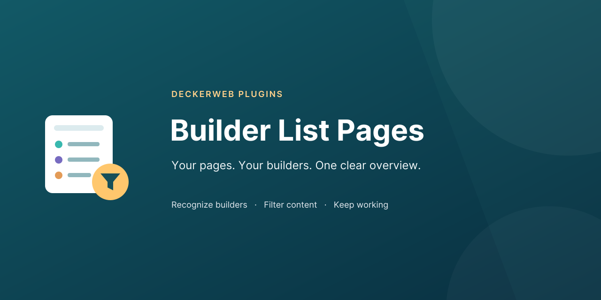

**Your pages. Your builders. One clear overview.**

Recognize builders and filter their content in familiar WordPress lists.

[Plugin website](https://deckerwebplugins.com/en/plugins/builder-list-pages/) · [User guide](https://github.com/deckerweb/builder-list-pages/wiki/English) · [Supported builders](https://github.com/deckerweb/builder-list-pages/wiki/Builders-English) · [Downloads](https://github.com/deckerweb/builder-list-pages/releases)

---

**Deine Seiten. Deine Builder. Alles im Blick.**

Erkenne Builder und filtere ihre Inhalte in vertrauten WordPress-Listen.

[Plugin-Website](https://deckerwebplugins.com/de/plugins/builder-list-pages/) · [Anleitung](https://github.com/deckerweb/builder-list-pages/wiki/Deutsch) · [Unterstützte Builder](https://github.com/deckerweb/builder-list-pages/wiki/Builders-Deutsch) · [Downloads](https://github.com/deckerweb/builder-list-pages/releases)

[Help / Hilfe](https://github.com/deckerweb/builder-list-pages/issues) · [Discussions / Austausch](https://github.com/deckerweb/builder-list-pages/discussions) · [Security / Sicherheit](https://github.com/deckerweb/builder-list-pages/blob/main/SECURITY.md)
